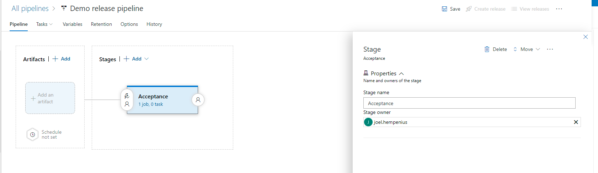
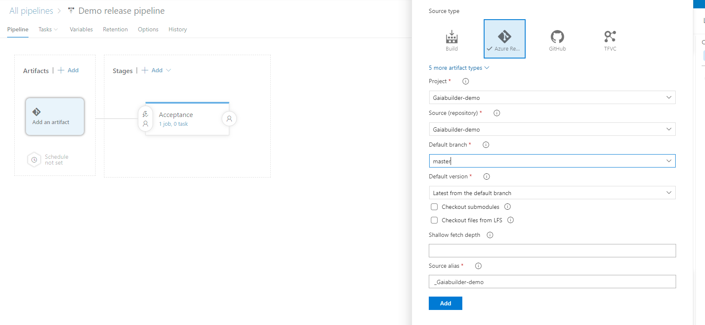
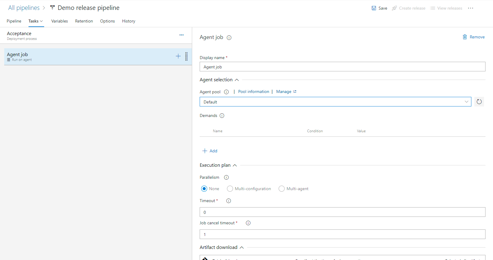
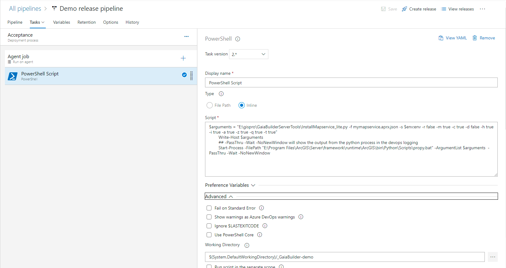
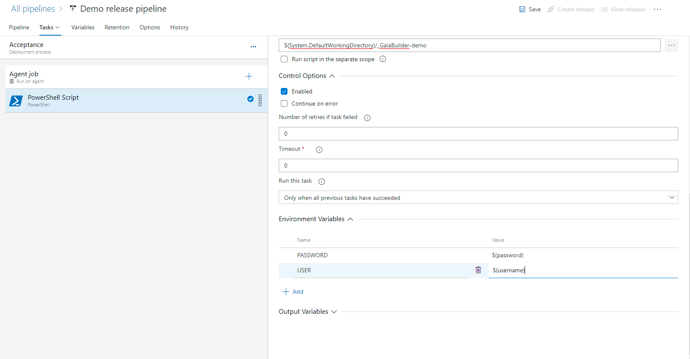
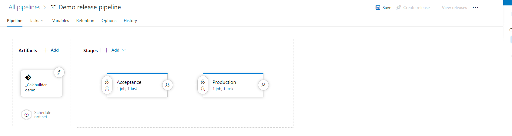
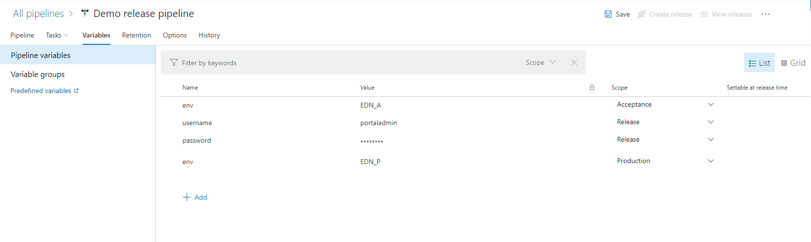

# Azure
This folder contains everything needed to run ArcGIS Enterprise deployments from Azure DevOps: YAML pipeline templates, a worked example of a classic release pipeline, and `pipeline.ps1`, the PowerShell script that actually drives the GaiaBuilder publish scripts.

## Table of contents
- [Azure](#azure)
- [Configuring a release pipeline](#configuring-a-release-pipeline)
- [Controlling pipeline.ps1 from a YAML pipeline](#controlling-pipelineps1-from-a-yaml-pipeline)
- [What pipeline.ps1 does](#what-pipelineps1-does)

The azure pipelines can be created from the templates. Change the following items in the pipeline to make it work with your Azure Devops
- trigger : none or the branch or branches as list. A push trigger specifies which branches cause a continuous integration build to run.
- pool -> name: the agent pool you want to use for the build, this should match the agent which is installed with ArcGIS Server or ArcGIS Pro
- script: update the directories for the ArcGIS Server Python, the GaiaBuilder Directory , the file you want to deploy and the environment it should be deployed to
- env -> USER: the Portal build-in user you want to use for authentication in the build
- env -> PASSWORD: the password variable as secret configured on your pipeline, store the password as a secret in the pipeline to avoid storing the password in the repository.

# Configuring a release pipeline
A build pipeline in for Azure Devops can be found in the templates. However, a release pipeline isn't a yaml file in the repository and therefore it is shared as a basic instruction
- Create a new release pipeline. Rename the first to the environment your release pipeline will deploy first:


- Add an artifact, this will be the git repository where your maps and content are stored. In this example, the master branch is checked out. Take a note of the source alias, you will need it in the coming steps

- Configure the agent job to use the Agent Pool where the GaiaBuilder build scripts are installed, in this example 'Default'

- Add a Powershell script step to the agent. The script could look like this. Change the paths where necessary to point to your propy.bat installation and the GaiaBuilder scripts installation. $env:env will insert the ArcGIS Enterprise environment into the arguments at run time from the Pipeline variables
```$arguments = "E:\gispro\GaiaBuilderServerTools\InstallMapservice_lite.py -f public_transport.aprx.json -s $env:env -r false -m true -c true -d false -h true -i true -a true -z true -q true -t true"
        Write-Host $arguments
        ## -PassThru -Wait -NoNewWindow will show the output from the python process in the devops logging
        Start-Process -FilePath "E:\Program Files\ArcGIS\Server\framework\runtime\ArcGIS\bin\Python\Scripts\propy.bat" -ArgumentList $arguments  -PassThru -Wait -NoNewWindow
```
Set the working directory under Advanced, $(System.DefaultWorkingDirectory)/_YOUR_SOURCE_ALIAS_

- Configure the environment variables to set the Portal for ArcGIS Username and Password. The names must be USER and PASSWORD, the values will be the pipeline variables which will be configured in the next steps.

- Duplicate the Stage using the + button and rename the stage to the next environment

- Go to variables and create the necessary variables. For this example you will need 'env', 'username' and 'password', don't forget to make the password variable a secret. You can assign a variable for the whole release pipeline, or duplicate them and make them specific for a Stage. In this example, the env variable is duplicated, which means th Acceptance Stage will deploy to the EDN_A ArcGIS Enterprise environment and the Production Stage will deploy to the EDN_P ArcGIS Enterprise environment.

- A post deployment condition can be added after each stage. This will pause the release pipeline until approval is given or stop the pipeline when a release is rejected. This gives the opportunity to do a manual test of the release at that stage and environment.
[[create_release_pipeline_7.png]]

# Controlling pipeline.ps1 from a YAML pipeline
Instead of writing all the GaiaBuilder logic inline in a YAML pipeline (as in the release pipeline example above), a YAML build pipeline can simply call `pipeline.ps1` and pass it configuration through environment variables. The script lives once on the agent (or is checked out with the repo) and is reused by every pipeline, so changes to the publish logic only need to be made in one place.

A minimal pipeline that triggers on changes and lets a user manually pick a target environment and an optional file list looks like this (see `Templates/Generic/azure-pipelines.yml` for the full example):

```yaml
trigger:
  branches:
    include:
      - develop
  paths:
    include:
      - sd_letters_service/**

pool:
  name: 'Arcgis'

variables:
- group: ArcGIS_Credentials   # must contain portal_username and portal_password (secret)

# Parameters only apply to manual runs; CI runs always use the defaults (DEV, Git diff).
parameters:
  - name: server
    displayName: Target Environment
    type: string
    default: DEV
    values:
      - DEV
      - TEST
      - ACC
      - PROD
  - name: manual_build_list
    displayName: Enter the files to publish (blank = use Git diff)
    type: string
    default: ' '

steps:
- checkout: self
  fetchDepth: 2 # this will ensure a GIT diff can be executed
- task: PowerShell@2
  displayName: Publish to ArcGIS
  inputs:
    filePath: 'C:/GaiaBuilder/pipeline.ps1'
  env:
    server: ${{ parameters.server }}
    manual_build_list: ${{ parameters.manual_build_list }}
    USER: $(portal_username)
    PASSWORD: $(portal_password)
```

Key points:
- `filePath` points at wherever `pipeline.ps1` is installed on the agent (it does not need to live in your content repository).
- `fetchDepth: 2` is required so `git diff-tree` has a previous commit to diff against when no manual build list is supplied.
- All configuration is passed via `env:` — the script itself doesn't read pipeline parameters directly, only environment variables.
- Making `server` and `manual_build_list` pipeline parameters lets someone trigger a manual run from the DevOps UI to republish specific files to a specific environment, while scheduled/CI runs just use the defaults (publish whatever changed, to DEV).

# What pipeline.ps1 does
`pipeline.ps1` figures out which ArcGIS items (map services, geoprocessing services, content, portal configuration) need to be (re)published, then calls the relevant GaiaBuilder Python scripts for each one. It is configured entirely through environment variables, so the same script works unchanged across every pipeline and environment.

**Environment variables it reads**
| Variable | Purpose |
|---|---|
| `server` | Name of the ArcGIS Enterprise environment to publish to (passed on to GaiaBuilder). |
| `manual_build_list` | Optional comma-separated list of files/wildcards to build manually. Leave blank to build based on the Git diff instead. |
| `includecontent` | Set to `"0"` to skip publishing content items. Defaults to including content. |
| `publish_sd_to_online` | Set to `"0"` to skip `.online.aprx.json` files (ArcGIS Online publishes). Defaults to publishing them. |
| `rewrite_connection` | Set to `"0"` to skip restoring/rewriting the data source connection (`-q` flag) during map service builds. Defaults to restoring. |
| `fail_on_empty_manual_build_list` | Set to `"0"` to allow the build to succeed even if `manual_build_list` was specified but none of its entries resolved to a map service, geoprocessing service, content, or portal config item. Defaults to failing the build in that case — a manual build list is an explicit request to publish something, so resolving nothing usually means a typo'd path or an empty wildcard. This check does not apply to the Git-diff mode: "nothing changed" is a normal, successful outcome there. |
| `USER` / `PASSWORD` | Not read by the script itself — they are picked up by the underlying GaiaBuilder/`propy` Python processes for Portal authentication. |

**1. Determine which files to build**
- If `manual_build_list` is set, it is split on commas and each entry is expanded by `Expand-BuildListEntry`:
  - `*` expands to every `.json` file under the working directory (recursive).
  - `folder/*` (or `folder\*`, including nested paths like `a/b/c/*`) expands to every `.json` file under that folder only.
  - Anything else is treated as a literal file path.
- If `manual_build_list` is empty, the script falls back to `git diff-tree` to find files changed in the last commit (and if that comes up empty, e.g. for a merge commit, it falls back again to `git log -m --name-status`).

**2. Classify each candidate file**
For every file found above, the script works out what kind of ArcGIS item it belongs to:
- `*.aprx.json` files are added directly to the map service build list (skipped if they are `.online.aprx.json` and `publish_sd_to_online` is `"0"`).
- Other changed files (e.g. a `.lyrx`/`.mapx`/`.aprx` source file) are used to derive the matching `*.aprx.json` filename, which is then added to the build list.
- If a `content.json`, `gpservice.json` or `portalconfig.json` file exists in the same folder as the changed file — or in any parent folder, via `Find-ConfigUpward` — it is queued into the content, geoprocessing service, or portal config lists respectively.
- Duplicate entries are not added twice to any list.

**3. Publish**
For each item queued above, the script:
1. Calls `GaiaBuilder.py -a listservers` to resolve which physical server(s) the item should be published to for the target `server` environment.
2. Calls the matching GaiaBuilder script for each resolved server via `Start-Process` (so the Python output streams into the DevOps log):
   - `ConfigurePortal.py` for portal configuration items.
   - `InstallMapservice_lite.py` for map services.
   - `InstallGeoProcessor_lite.py` for geoprocessing services.
   - `InstallContent_lite.py` for content items (only if `includecontent` is not `"0"`).

Portal configuration is applied first, then map services, then geoprocessing services, then content. The exit codes of all the spawned Python processes are summed and returned as the script's own exit code, so the pipeline step fails if any publish step fails.
